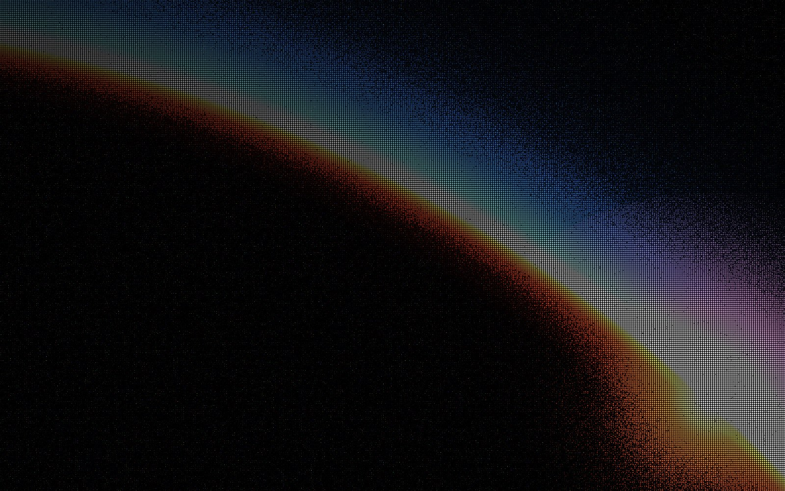
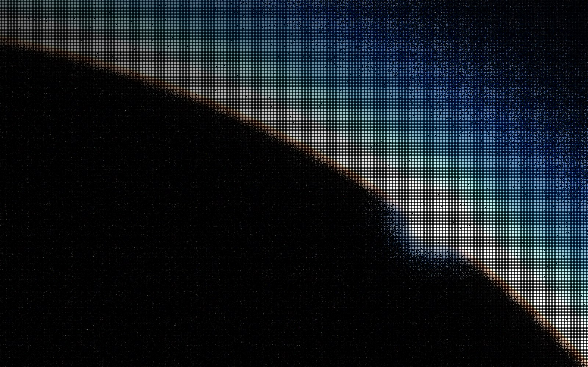
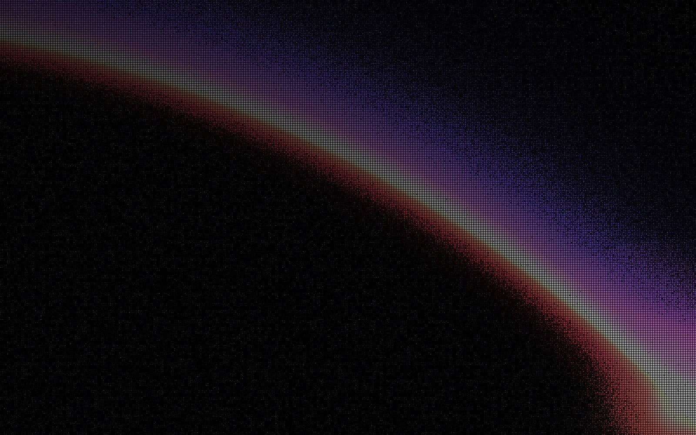
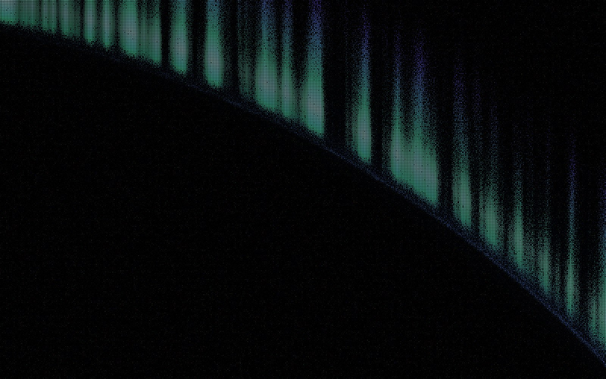

# Horizon

A Claude Code mod for the Desktop app's Code tab. It puts a planet's limb behind the conversation, drawn through a fine screen of colored, dithered dots. The light follows your local time of day, and the app's own colors change to match the scene.

## Time of day

| Hours | Scene |
| --- | --- |
| 05–08 | Dawn: a red-orange rim, a white edge, blue air |
| 08–17 | Day: a white-blue rim with the sun high on the limb |
| 17–20 | Dusk: a crimson rim and violet air |
| 20–05 | Night: a dark planet with a green aurora over the rim |

| Dawn | Day |
| --- | --- |
|  |  |
| **Dusk** | **Night** |
|  |  |

The mod checks the clock every 10 minutes and redraws only when the time of day changes.

## Commands

- `/horizon`: turn the backdrop on and follow the clock.
- `/horizon dawn`, `/horizon day`, `/horizon dusk`, `/horizon night`: pin one time of day.
- `/horizon auto`: follow the clock again.
- `/horizon-off`: remove the backdrop and the colors.

## Notes

- The backdrop draws in the Desktop and mobile apps only. The terminal keeps its own look.
- The scene is one SVG with CSS motion and SVG filters, and it runs no script. With reduced motion turned on, the scene stays still.
- The app colors are a fixed dark palette in `hooks/palette.ts`: night-blue surfaces and a sunlit orange accent.
